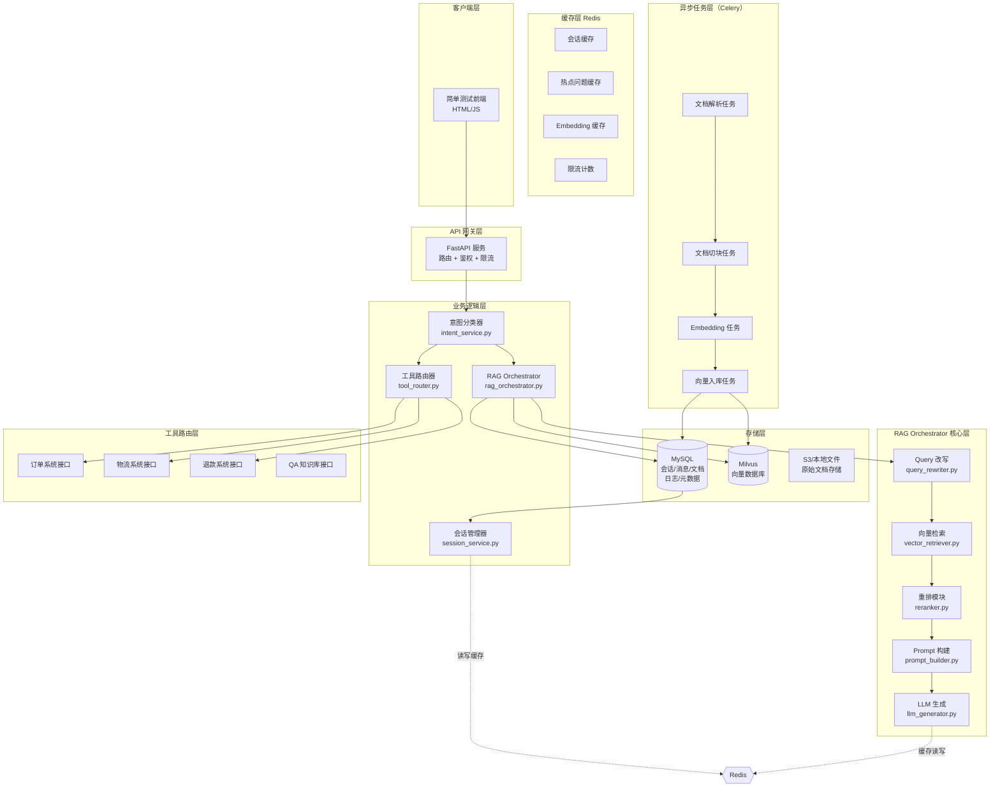

# RAG 电商智能客服系统 - 项目计划（完整架构版）

---

## 一、项目架构总览




---

## 二、技术选型


| 组件               | 技术选型                     | 说明                                   |
| ---------------- | ------------------------ | ------------------------------------ |
| 后端框架             | FastAPI                  | 高性能 async，Swagger 文档自动生成             |
| RAG Orchestrator | 自研 Pipeline              | Query改写 + 检索 + 重排 + Prompt构建 + LLM生成 |
| LLM 抽象层          | 自研 LLMBase + Provider 模式 | 支持 qwen-max，便于切换其他模型                 |
| 向量数据库            | Milvus                   | 企业级，高性能ANN检索                         |
| Embedding        | 通义文本 Embedding           | 阿里云文本嵌入模型                            |
| 结构化存储            | MySQL 8.0                | 会话、消息、文档元数据、系统日志                     |
| 缓存层              | Redis                    | 会话缓存、热点问题缓存、Embedding 缓存、限流          |
| 异步任务             | Celery + Redis Broker    | 文档解析、切块、Embedding、向量入库               |
| 意图分类             | 规则 + LLM 双层              | 规则兜底，LLM 精细分类                        |
| 工具路由             | 自研 ToolRouter            | 订单/物流/退款/QA 系统接口统一封装                 |
| 前端               | 原生 HTML + JS             | 纯前端，无构建依赖，快速测试                       |
| 部署               | Docker + Docker Compose  | 一键启动全套服务                             |


---

## 三、功能模块设计

### 3.1 RAG Orchestrator 核心层

#### Query 改写 (query_rewriter.py)

- 多轮补全: 提取指代词（如"这个"、"它"）还原完整 query
- 同义词扩展: 电商领域同义词扩展（如"手机" -> "智能手机"）
- Query 去噪: 过滤语气词、重复词，提取核心实体
- 历史摘要: 结合上一轮对话，对模糊问题进行补全

#### 向量检索 (vector_retriever.py)

- 多路召回: 商品向量检索 + FAQ 向量检索 + 政策文档检索
- 混合检索: dense vector + sparse keyword (BM25) 混合
- 分组检索: 按商品类目/文档类型分组检索
- 过滤条件: 支持 metadata 过滤（商品类目、价格区间等）

#### 重排模块 (reranker.py)

- Cross-Encoder 重排: 对 top-k 候选文档做精细化相关性打分
- 业务规则干预: 优先展示高权重内容（如新品、活动商品）
- 去重策略: MMR（最大边际相关性）减少内容重复

#### Prompt 构建 (prompt_builder.py)

- 动态模板: 根据意图类型选择不同 prompt 模板
- 上下文注入: 会话历史摘要 + 召回文档 + 用户画像
- Token 控制: 基于 token 预算动态截断上下文
- Few-shot 示例: 为复杂场景注入示例提升准确率

#### LLM 生成 (llm_generator.py)

- 流式输出: SSE/流式响应，支持打字机效果
- 引用标注: 生成内容中标注引用来源
- 安全过滤: 敏感词检测和过滤

### 3.2 意图分类 (intent_service.py)

- 分类类别: product_qa | order_query | refund_return | general_chat
- 策略: 关键词规则兜底 + LLM 分类
- 实现: 输入用户 query -> 输出意图标签 -> 路由到对应 handler

### 3.3 工具路由层 (tool_router.py)

- 统一接口: ToolRouter.execute(intent, params) 统一调度所有业务接口
- 接口注册: 装饰器 @register_tool(intent_name, param_schema) 自动注册
- 熔断降级: 接口超时/失败时返回兜底话术
- 接入系统: 订单查询 / 物流查询 / 退款进度 / FAQ 知识库

### 3.4 订单查询 (order_service.py)

- 接口: 订单详情 / 物流状态 / 收货地址（mock 数据 + 可扩展真实 API）
- 实现: 意图识别订单号 -> 查询 mock 数据 -> LLM 格式化输出

### 3.5 退换货辅助 (refund_service.py)

- 流程: 判断是否符合退换货条件 -> 指导操作步骤 -> 触发工单
- 基于知识库 RAG + 流程指引

### 3.6 多轮会话 (session_service.py)

- Session 存储: MySQL 持久化 + Redis 缓存（双写）
- 上下文窗口: 最近 N 轮对话摘要 + 当前商品上下文
- 去重: 相同问题不重复 RAG 检索

### 3.7 LLM 抽象层 (llm_service.py)

- 接口统一: LLMBase 抽象类
- Provider: QwenProvider 实现 qwen-max 调用
- 扩展性: 预留 ClaudeProvider / GPTProvider / OllamaProvider 接口
- 工厂模式: 根据配置自动加载对应 Provider

---

## 四、项目目录结构

```
RAG/
├── SPEC.md                          # 项目规格说明文档
├── README.md                        # 项目说明
├── requirements.txt                 # Python 依赖
├── Dockerfile                        # 后端容器化
├── docker-compose.yml               # 统一编排（后端 + Milvus + MySQL + Redis + Celery）
│
├── backend/
│   ├── app/
│   │   ├── __init__.py
│   │   ├── main.py                  # FastAPI 入口，路由注册，中间件
│   │   ├── config.py                # 配置管理（环境变量）
│   │   │
│   │   ├── models/                  # Pydantic 数据模型
│   │   │   ├── __init__.py
│   │   │   ├── request.py           # ChatRequest, QueryRequest
│   │   │   └── response.py          # ChatResponse, ErrorResponse
│   │   │
│   │   ├── api/                     # API 路由层
│   │   │   ├── __init__.py
│   │   │   ├── chat.py              # POST /chat, GET /chat/history
│   │   │   ├── intent.py            # POST /intent 意图分类接口
│   │   │   ├── admin.py             # 管理接口：文档上传/知识库管理
│   │   │   └── health.py            # GET /health 健康检查
│   │   │
│   │   ├── services/                # 业务逻辑层
│   │   │   ├── __init__.py
│   │   │   ├── llm_service.py        # LLM 抽象层 + Provider 实现
│   │   │   ├── rag_orchestrator.py   # RAG Orchestrator 核心编排器
│   │   │   ├── query_rewriter.py    # Query 改写模块
│   │   │   ├── vector_retriever.py   # 向量检索模块
│   │   │   ├── reranker.py          # 重排模块
│   │   │   ├── prompt_builder.py     # Prompt 动态构建
│   │   │   ├── embedding_service.py  # 文本向量化
│   │   │   ├── intent_service.py     # 意图分类
│   │   │   ├── session_service.py    # 多轮会话管理
│   │   │   ├── order_service.py      # 订单查询
│   │   │   ├── refund_service.py     # 退换货流程
│   │   │   └── tool_router.py       # 工具路由层
│   │   │
│   │   ├── database/               # MySQL 数据库层
│   │   │   ├── __init__.py
│   │   │   ├── connection.py        # MySQL 连接池
│   │   │   ├── session.py           # 会话表 CRUD
│   │   │   ├── message.py           # 消息表 CRUD
│   │   │   ├── document.py          # 文档元数据表 CRUD
│   │   │   └── log.py               # 操作日志表
│   │   │
│   │   ├── cache/                  # Redis 缓存层
│   │   │   ├── __init__.py
│   │   │   ├── redis_client.py      # Redis 连接
│   │   │   ├── session_cache.py     # 会话缓存
│   │   │   ├── hot_question.py      # 热点问题缓存
│   │   │   └── embed_cache.py       # Embedding 结果缓存
│   │   │
│   │   ├── vectorstore/             # 向量存储层
│   │   │   ├── __init__.py
│   │   │   └── milvus_client.py     # Milvus 连接和操作封装
│   │   │
│   │   └── utils/
│   │       ├── __init__.py
│   │       └── prompt_template.py   # Prompt 模板管理
│   │
│   ├── celery_app/
│   │   ├── __init__.py
│   │   ├── celery_config.py         # Celery 配置
│   │   └── tasks/
│   │       ├── __init__.py
│   │       ├── doc_parser.py        # 文档解析任务（PDF/Word/HTML）
│   │       ├── chunker.py           # 文档切块任务
│   │       ├── embed_task.py        # 向量化任务
│   │       └── vector_index.py      # 向量入库任务
│   │
│   └── tests/
│       ├── __init__.py
│       ├── test_intent.py
│       ├── test_rag.py
│       ├── test_reranker.py
│       ├── test_session.py
│       └── test_api.py
│
├── frontend/
│   ├── index.html                   # 客服对话主页面
│   ├── chat.js                      # 对话逻辑
│   └── style.css                    # 基础样式
│
├── data/
│   ├── products.json                # 模拟商品数据
│   ├── orders.json                  # 模拟订单数据
│   ├── refund_policy.json           # 退换货政策
│   └── knowledge_base.json          # 知识库文档（商品 FAQ 等）
│
├── scripts/
│   ├── init_milvus.py               # 初始化 Milvus collection 和索引
│   ├── embed_products.py            # 将商品数据批量向量化入库
│   └── init_mysql.sql               # MySQL 表结构初始化脚本
│
├── .cursor/
│   └── rules/
│       ├── rag-patterns.mdc
│       ├── fastapi-best-practices.mdc
│       ├── llm-abstraction.mdc
│       ├── ecommerce-domain.mdc
│       └── celery-async-patterns.mdc
│
└── skills/
    ├── rag-debug.skill.md
    ├── ecommerce-rag-dev.skill.md
    └── cursor-workflow.skill.md
```

---

## 五、数据模型

### 5.1 MySQL 表结构

#### sessions 表（会话）

```sql
CREATE TABLE sessions (
    id VARCHAR(36) PRIMARY KEY,
    user_id VARCHAR(64) NOT NULL,
    intent VARCHAR(32),
    status ENUM('active','closed') DEFAULT 'active',
    created_at DATETIME DEFAULT CURRENT_TIMESTAMP,
    updated_at DATETIME ON UPDATE CURRENT_TIMESTAMP,
    summary TEXT,
    metadata JSON
);
```

#### messages 表（消息）

```sql
CREATE TABLE messages (
    id BIGINT AUTO_INCREMENT PRIMARY KEY,
    session_id VARCHAR(36) NOT NULL,
    role ENUM('user','assistant','system') NOT NULL,
    content TEXT NOT NULL,
    intent VARCHAR(32),
    sources JSON,
    tokens INT,
    latency_ms INT,
    created_at DATETIME DEFAULT CURRENT_TIMESTAMP,
    FOREIGN KEY (session_id) REFERENCES sessions(id)
);
```

#### documents 表（文档元数据）

```sql
CREATE TABLE documents (
    id BIGINT AUTO_INCREMENT PRIMARY KEY,
    doc_type ENUM('product','policy','faq','manual') NOT NULL,
    title VARCHAR(255) NOT NULL,
    file_path VARCHAR(512),
    file_hash VARCHAR(64),
    chunk_count INT,
    status ENUM('pending','processing','done','failed') DEFAULT 'pending',
    created_at DATETIME DEFAULT CURRENT_TIMESTAMP,
    indexed_at DATETIME
);
```

#### logs 表（操作日志）

```sql
CREATE TABLE logs (
    id BIGINT AUTO_INCREMENT PRIMARY KEY,
    level ENUM('info','warn','error') NOT NULL,
    service VARCHAR(64) NOT NULL,
    action VARCHAR(128) NOT NULL,
    request_id VARCHAR(36),
    detail JSON,
    created_at DATETIME DEFAULT CURRENT_TIMESTAMP
);
```

### 5.2 Redis Key 设计


| Key Pattern                  | 类型     | 说明             | TTL   |
| ---------------------------- | ------ | -------------- | ----- |
| session:{session_id}         | Hash   | 会话上下文缓存        | 30min |
| session:{session_id}:history | List   | 最近 N 轮消息       | 30min |
| hot:questions:day            | ZSet   | 当日热点问题评分       | 24h   |
| embed:cache:{hash}           | String | Embedding 结果缓存 | 7d    |
| rate:user:{user_id}          | String | 用户限流计数         | 1min  |
| tool:circuit:{tool_name}     | String | 熔断器状态          | 30s   |


### 5.3 API 数据模型

#### ChatRequest

```python
{
    "session_id": str,
    "message": str,
    "user_id": str = "guest"
}
```

#### ChatResponse

```python
{
    "session_id": str,
    "message": str,
    "intent": str,
    "sources": list[str],
    "tokens_used": int,
    "latency_ms": int,
    "timestamp": str
}
```

---

## 六、Cursor Rules 和 Skills 配置

### 6.1 Cursor Rules (.cursor/rules/)

- **rag-patterns.mdc** - RAG 系统的核心开发规范
  - RAG Orchestrator Pipeline 流程规范（Query改写 -> 检索 -> 重排 -> Prompt -> LLM）
  - Milvus 使用的最佳实践（索引类型、分区、top_k 参数）
  - 重排模块设计原则（Cross-Encoder vs Bi-Encoder）
  - Prompt 模板设计原则（动态注入、Token 控制）
  - Embedding 缓存策略
- **fastapi-best-practices.mdc** - FastAPI 开发规范
  - 路由设计规范（RESTful）
  - Pydantic 模型设计
  - 异步最佳实践（async/await）
  - 中间件和依赖注入模式
  - 后台任务集成（Celery + FastAPI）
- **llm-abstraction.mdc** - LLM 抽象层规范
  - Provider 接口设计模式（LLMBase 抽象类）
  - 模型切换的无缝过渡规范
  - Token 预算和成本控制
  - 流式输出规范（SSE）
- **ecommerce-domain.mdc** - 电商客服领域规范
  - 意图分类体系（product_qa / order_query / refund_return / general_chat）
  - 多轮对话上下文管理策略（MySQL + Redis 双写）
  - 工具路由层设计（熔断降级、装饰器注册）
  - 敏感信息处理规范（订单号、金额脱敏）
- **celery-async-patterns.mdc** - Celery 异步任务规范
  - 任务拆分原则（文档解析 / 切块 / Embedding / 入库）
  - 重试策略和死信队列
  - Celery Beat 定时任务
  - 与 FastAPI 的集成模式

### 6.2 Cursor Skills (skills/)

- **rag-debug.skill.md** - RAG 系统调试技能
  - 检索质量诊断（召回率低/高/噪声大的排查方法）
  - 生成质量评估（幻觉、相关性判断）
  - Milvus 性能调优（索引调优、查询参数）
  - RAG Orchestrator 各环节日志追踪
  - 常见错误码处理（Milvus / Redis / MySQL / Celery）
- **ecommerce-rag-dev.skill.md** - 电商 RAG 开发助手技能
  - 商品知识库构建流程（文档解析 -> 切块 -> 向量化）
  - FAQ 设计规范（问题-答案对的质量标准）
  - 意图分类器快速迭代
  - 多轮对话状态机设计
  - 工具路由层扩展新接口的规范流程
- **cursor-workflow.skill.md** - Cursor 编程工作流技能
  - 代码生成规范
  - 快速调试技巧
  - Cursor Rules 和 Skills 编写指南

---

## 七、Docker 部署架构

```yaml
# docker-compose.yml
services:
  backend:
    build: ./backend
    ports: ["8000:8000"]
    environment:
      - MILVUS_HOST=milvus
      - MILVUS_PORT=19530
      - MYSQL_HOST=mysql
      - MYSQL_PORT=3306
      - REDIS_HOST=redis
      - REDIS_PORT=6379
      - CELERY_BROKER_URL=redis://redis:6379/1
      - CELERY_RESULT_BACKEND=redis://redis:6379/2
      - LLM_API_KEY=${LLM_API_KEY}
      - DASHSCOPE_API_KEY=${DASHSCOPE_API_KEY}
    depends_on:
      - milvus
      - mysql
      - redis
    volumes:
      - ./data:/app/data

  celery_worker:
    build: ./backend
    command: celery -A celery_app worker --loglevel=info
    environment:
      - CELERY_BROKER_URL=redis://redis:6379/1
      - CELERY_RESULT_BACKEND=redis://redis:6379/2
      - MILVUS_HOST=milvus
      - MYSQL_HOST=mysql
    depends_on:
      - redis
      - milvus
      - mysql

  celery_beat:
    build: ./backend
    command: celery -A celery_app beat --loglevel=info
    environment:
      - CELERY_BROKER_URL=redis://redis:6379/1
    depends_on:
      - redis

  mysql:
    image: mysql:8.0
    ports: ["3306:3306"]
    environment:
      - MYSQL_ROOT_PASSWORD=${MYSQL_ROOT_PASSWORD}
      - MYSQL_DATABASE=rag_customer_service
    volumes:
      - mysql_data:/var/lib/mysql
      - ./scripts/init_mysql.sql:/docker-entrypoint-initdb.d/init.sql

  redis:
    image: redis:7-alpine
    ports: ["6379:6379"]
    volumes:
      - redis_data:/data

  milvus:
    image: milvusdb/milvus:v3.0.0
    ports: ["19530:19530", "9091:9091"]
    volumes:
      - milvus_data:/var/lib/milvus
```

---

## 八、实施计划

**Phase 1 - 项目初始化与数据准备（1-2天）**

- 初始化 Python 项目，创建目录结构
- 编写 requirements.txt（FastAPI, pymilvus, mysql-connector-python, redis, celery, dashscope 等）
- 编写 SPEC.md 详细规格说明
- 生成模拟商品数据（50-100条商品）
- 生成模拟订单数据
- 编写退换货政策知识库

**Phase 2 - 基础设施层（1-2天）**

- MySQL 表结构设计与初始化脚本（init_mysql.sql）
- MySQL 连接池封装（database/connection.py）
- Redis 连接封装（cache/redis_client.py）
- Celery 应用配置与任务目录结构
- docker-compose 全家桶配置
- 配置管理（config.py）统一管理 MySQL/Redis/Milvus/Celery 连接参数

**Phase 3 - RAG Orchestrator 核心层（2-3天）**

- RAG Orchestrator 编排器主类（rag_orchestrator.py）
- Query 改写模块（query_rewriter.py）
- 向量检索模块（vector_retriever.py）- 多路召回 + 混合检索
- 重排模块（reranker.py）- Cross-Encoder 打分 + MMR 去重
- Prompt 动态构建器（prompt_builder.py）
- LLM 生成器（llm_generator.py）- 流式输出 + 引用标注
- Embedding 服务封装
- Milvus 初始化脚本（init_milvus.py）
- LLM 抽象层 + Qwen-Max Provider

**Phase 4 - 业务功能层（2-3天）**

- MySQL 数据访问层（会话、消息、文档、日志 CRUD）
- Redis 缓存层（会话缓存、热点问题、Embedding 缓存）
- 意图分类服务（规则 + LLM 双层）
- 会话管理服务（MySQL 持久化 + Redis 缓存）
- 工具路由层（tool_router.py）+ 订单/物流/退款接口 mock
- 订单查询服务 + 退换货辅助服务
- API 路由层串联
- Celery 异步任务（文档解析 / 切块 / Embedding / 向量入库）

**Phase 5 - 前端与部署（1-2天）**

- 简单测试前端（HTML + JS）
- Docker + docker-compose 配置
- 端到端测试

**Phase 6 - Cursor Rules 和 Skills（并行进行）**

- 编写 5 个 Cursor Rules（新增 celery-async-patterns.mdc）
- 编写 3 个 Cursor Skills
- 文档化使用指南

**总工期预估: 8-12 个工作日**

---

## 九、关键设计决策说明

1. **RAG Orchestrator**: 单一编排器收口所有 RAG 流程，各子模块（Query改写/检索/重排/Prompt/LLM）可独立替换，确保端到端可观测性和流程可控性
2. **MySQL 结构化存储**: 会话和消息持久化便于审计追溯和数据分析，文档元数据管理支持知识库生命周期管理
3. **Redis 多级缓存**: 会话缓存（热路径加速）+ 热点问题缓存（减轻 LLM 负载）+ Embedding 缓存（减少重复向量计算）
4. **Celery 异步任务**: 文档处理是 CPU/IO 密集型耗时操作（解析/切块/向量化），异步化避免阻塞 API 响应
5. **工具路由层**: 统一封装外部业务系统接口，熔断降级保证系统韧性，装饰器注册机制使扩展新接口零改动
6. **LLM 扩展性**: LLMBase 抽象类 + Provider 模式，配置文件切换模型，零代码改动换模型

